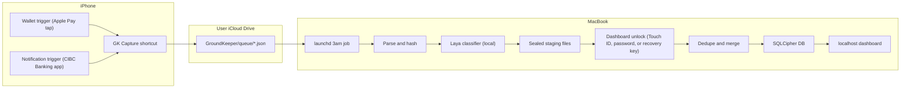
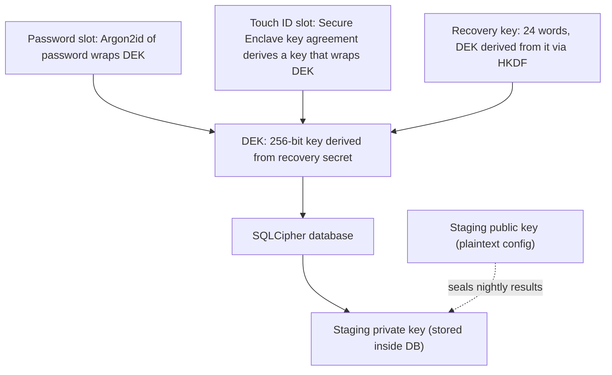
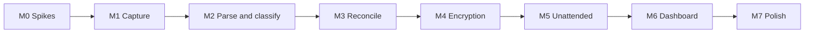

# GroundKeeper: High-Level Architecture

## 1. The end-to-end flow




Key idea: the 3am job **never holds the database key**. It only has a public key, so it can write sealed results but can't read anything. Merging and deduplication happen when the user unlocks the dashboard. This is what lets the background job run unattended while the database stays locked.

## 2. Capture on the iPhone: what actually works

- **Wallet trigger (reliable):** Shortcuts, then Automation, then Wallet (called "Transaction" before iOS 26). Set it to **Run Immediately**. The trigger input exposes **Amount, Merchant, Name, and Card or Pass**. It adds no timestamp and no transaction ID, so use `Current Date`. It only fires for Apple Pay / Wallet taps; physical card swipes, online card-number payments, and subscriptions never trigger it.
- **Bank notification trigger (new in this iOS release):** Shortcuts, then Automation, then "When I receive a notification from [app]". Pick **CIBC Banking**, and add another trigger for each bank app you use. Filters can match on **Title, Subtitle, and Message**, with "contains".
  - Enable CIBC's "notify me on every purchase" style alerts in the CIBC app.
  - Filter narrowly so balance alerts and marketing pushes don't fire it. For example, match Message contains `purchase` (or `$`), using wording taken from real CIBC notification samples.
  - If you need several wordings (purchases, refunds, e-Transfers), make one automation per wording. Every automation calls the same shortcut.
  - The on-screen hint ("Configure Title and Subtitle to enable this automation") means each filter row must be filled in or removed with the minus button.
- **Caveat to verify first:** early reports from Apple's WWDC demo and beta testers say this trigger only *filters* on notification text and **may not pass the title and body into the shortcut as Shortcut Input**. Some testers also saw filters fail to match.
  - Spike: build the automation with a single `Quick Look` of `Shortcut Input`. Check whether it contains the title, subtitle, and body, both with the phone unlocked and locked, and with notification previews set to "Always".
  - **If the text is passed:** this is the primary bank source. It's faster and cleaner than email or SMS.
  - **If only the trigger fires:** the shortcut can't read the amount or merchant, so fall back to CIBC **email alerts** (Email trigger) or **SMS alerts** (Message trigger). Both expose their content and can run immediately. The notification trigger could still record a content-free "bank ping" with a timestamp, but that isn't enough to build a transaction.
- **Shared "GK Capture" shortcut:** every automation (Wallet and each notification wording) calls it through a single `Run Shortcut` action, with the trigger input passed along. This follows the beta-era advice to keep logic out of the automation itself: if an iOS update breaks an automation, rebuilding it is a one-action job.
- **Keep the shortcut simple:** it just writes a raw JSON file with no parsing on the phone. All parsing happens on the Mac, so a change in CIBC's wording only means updating a parser.
- **Notification field mapping:** the app name shown beside the icon is a system header, separate from the notification payload's title. The CIBC sample screenshot suggests a card-description title, a merchant subtitle, and an amount body, but a screenshot cannot prove that split. Save the exact Shortcut Input values before designing the parser; see `M0_SCOPE.md`.
- **Laya can't extract fields:** it only classifies, so amounts, merchants, and card last-4 digits in notification text come from **per-bank regex parsers** (`parsers/cibc.py`), written from real samples. Anything that fails to parse goes to an "unparsed" review list, and its raw text is kept so a parser fix can re-run over it.

Queue file (immutable, written once, never modified, so iCloud never hits a sync conflict):

```json
{
  "schema": 1,
  "id": "20260927T155210123-482913",
  "source": "wallet | bank_notification | bank_email | bank_sms",
  "app": "CIBC Banking",
  "captured_at": "2026-09-27T15:52:10-04:00",
  "amount_raw": "$5.75",
  "merchant": "Blue Bottle",
  "name": "...",
  "card": "CIBC Dividend Visa",
  "title": null,
  "subtitle": null,
  "body": null
}
```

Wallet captures fill `amount_raw`, `merchant`, `name`, and `card`. Notification captures fill `app`, `title`, `subtitle`, and `body`, and the Mac parses the rest.

- The filename is the `id`: a timestamp with milliseconds plus the output of the `Random Number` action, so two files never collide. Turn **"Overwrite if file exists" off**.
- The shortcut saves to `iCloud Drive/Shortcuts/GroundKeeper/queue.noindex/`. On the Mac, that folder is `~/Library/Mobile Documents/iCloud~is~workflow~my~workflows/Documents/GroundKeeper/queue.noindex/`. The `.noindex` suffix keeps Spotlight out (see the audit). Sibling folders: `staging.noindex/`, `quarantine/`, `backups/`, and `consumer.json`.

## 3. The nightly Mac job

- **Schedule:** a user **LaunchAgent** (not a LaunchDaemon, because it needs the user's iCloud session) with `StartCalendarInterval` set to 03:00. If the Mac is asleep at 3am, launchd runs the missed job on the next wake. Optionally, `pmset repeat wake` can wake the Mac on AC power.
- **Environment in the plist:** set `EnvironmentVariables` to `LAYA_DEVICE=mps` and `HF_HUB_OFFLINE=1`. Do not enable MPS-to-CPU op fallback by default; the M0 spike ran this checkpoint on MPS without it. launchd does not inherit your shell environment, so the variables have to be set there.
- **Evicted iCloud files:** mark the queue folder **"Keep Downloaded"** in Finder so files don't become `.icloud` placeholders. Skip any placeholders that still appear and retry them the next night.
- **Folder permissions:** macOS privacy controls (TCC) protect `~/Library/Mobile Documents`, so the Python interpreter the job runs under needs Full Disk Access. Packaging the job as a small app bundle later would let you grant a narrower permission.
- **Steps for each file:**
  1. Parse the JSON.
  2. Compute `sha256` of the content (used as the idempotency key).
  3. Normalize the merchant (strip prefixes like `SQ *` and `TST*`, and store numbers).
  4. Classify with Laya.
  5. Append a **sealed** record to `staging/` using a NaCl SealedBox with the staging public key.
  6. Delete the queue file.
- **Crash safety:** if the job dies after sealing but before the delete, the file is re-processed next run. The `content_hash` is a UNIQUE column, so the duplicate is dropped at merge time. Write each staging file to a temp name, `fsync` it, then rename it into place, and only after that delete the queue file.
- **One run at a time:** the 3am job and a dashboard unlock can both start the pipeline. Take an exclusive `flock` on `~/Library/Application Support/GroundKeeper/run.lock`, a local path, since file locks don't work reliably on iCloud. A second caller waits or exits.
- **Staging lives in iCloud (`GroundKeeper/staging/`), not only on the Mac.** Staging files are sealed, so they're safe there. If the Mac dies between the nightly run and the next unlock, the transactions survive, and a restored or new Mac can merge them. A local-only staging folder would mean the queue files are already deleted and the data is lost.
- **Bad or incomplete files:** if a queue file doesn't parse as JSON (for example, it's still syncing), skip it and don't delete it. After 3 failed nights, move it to `GroundKeeper/quarantine/` and show it in the review queue.
- **Single consumer:** only one Mac may drain the queue. At setup, write `GroundKeeper/consumer.json` (a device ID). The job refuses to run on any other Mac until the user runs `gk takeover`. This stops two Macs from each grabbing half of the transactions.
- **Why run nightly if merging waits for unlock:** the nightly run drains plaintext out of iCloud every day and pre-computes classifications. The same pipeline function also runs on dashboard unlock, so nothing waits for 3am.

## 4. Classification with Laya

- Run it in-process with `pip install laya` and `laya.load(...)`, **on the Apple GPU through PyTorch's Metal (MPS) backend**. Download the weights once from Hugging Face, then set `HF_HUB_OFFLINE=1` so the model never needs the network.
- **Pin the device to MPS:** in `classify.py`:
  1. Check `torch.backends.mps.is_available()` at startup.
  2. Load with `laya.load(..., device="mps")`; the M0 spike verified that this keyword works in Laya 0.3.11. `LAYA_DEVICE=mps` is useful for `laya-serve`, but do not rely on it for the direct SDK call.
  3. Check the agent device and a model parameter device after inference, so an internal CPU fallback shows up in the job log.
- **If MPS isn't available, fail loudly.** The job exits non-zero with a clear log message and leaves the queue files untouched for the next run, rather than quietly running on CPU. A `--allow-cpu` flag on `gk run` is the explicit escape hatch.
- **Unsupported ops:** leave `PYTORCH_ENABLE_MPS_FALLBACK` unset unless a future pinned dependency requires it; an M0 run completed without fallback. Re-test and log actual device placement after any upgrade.
- **Batching:** classify the whole night's queue in mini-batches (for example, 32 transactions per forward pass) to keep the GPU busy. The M0 12-item warm batch took about 0.4 seconds on this M4 Pro; cold startup and larger batches need separate measurement.
- Use one `choice` question over **at most 10 spending categories**: Groceries, Dining, Transport, Shopping, Subscriptions and Bills, Entertainment, Health, Travel, Personal Care, Other.
  - Why 10: Laya fits a separate calibration temperature for each option-count bucket. Its docs say the shipped `choice:11+` bucket was badly mis-calibrated, so the package now clamps it. With 10 or fewer options you avoid that bucket, but the 0.6 review threshold still needs task-specific validation; the M0 raw-string sample achieved only 3/12 correct.
  - If you want finer categories later, classify in two stages (coarse category first, then subcategory within it), each with 10 or fewer options.
- **Direction comes from the parser, not Laya.** Income, refunds, and transfers are recognized from the bank text ("refund", "deposit", "e-Transfer received") or from the sign of the amount, and they skip spending classification. Laya only ever answers "what kind of spending is this?"
- **Precedence:**
  1. A user merchant rule (`merchant_norm` mapped to a category) wins and skips Laya entirely.
  2. Otherwise use Laya's answer.
  3. If confidence is below a threshold chosen on labelled real fixtures (0.6 is only a starting candidate), flag the transaction for review.
- Every correction the user makes in the UI becomes a merchant rule, so accuracy improves quickly without fine-tuning. Fine-tuning on the corrections is an optional later step.

## 5. Idempotency and deduplication

There are two layers:

- **File-level idempotency:** the `raw_events.content_hash` column is UNIQUE, so re-reading the same file is a no-op.
- **Cross-source reconciliation:** a Wallet tap and a later bank alert for the same purchase should become **one** transaction with two linked raw events.

Tables:

- `raw_events`: one row per capture, with a foreign key to its transaction.
- `transactions`: the canonical purchases.

Matching rules, applied at merge time and processed in chronological order:

1. **Wallet events are never merged with each other.** Each tap is a real purchase, so two $5.75 coffees stay as two transactions.
2. For each bank event, the candidates are Wallet transactions that meet all of these:
  - not yet linked to a bank event
  - same currency and same amount in cents
  - same card, using a card-to-account mapping the user sets up once (for example, the Wallet card "CIBC Dividend Visa" is the CIBC card ending in 1234)
  - time difference within the window for that source. Push notifications usually land seconds after the tap, so use a tight window: -5 minutes to +2 hours. Email alerts or posted-transaction alerts keep the wider -10 minutes to +72 hours.
3. **Matching is one-to-one.** A bank event links to at most one Wallet transaction, and a Wallet transaction to at most one bank event. Pick the best candidate by merchant similarity, then by closeness in time, and fall back to **first-in-first-out**.
4. **Why same-price repeats are safe:** when several candidates are identical (same merchant, card, and amount), it doesn't matter which one pairs with which. Only the count matters, and one-to-one first-in-first-out keeps the count correct. Two taps plus two alerts give two transactions. Two taps plus one alert also give two transactions, one of them Wallet-only. Because push alerts arrive seconds after each tap, their order nearly always mirrors the tap order, which makes first-in-first-out pairing reliable.
5. **No match:** the bank event becomes its own transaction (for example, a physical card swipe).
5a. **Matching must work in both directions.** Queue files can arrive out of order (the phone was offline, or iCloud was slow), so a Wallet event can land *after* its bank alert was already merged as a standalone transaction. When a new event of either kind arrives, look for unlinked counterparts in the database within the window, not just in the current batch. Run every match over the combined set of new events plus unlinked existing ones, sorted by event time (in UTC), so the result doesn't depend on arrival order.
5b. **User decisions are sticky.** Manual merges, splits, and "not a duplicate" choices are stored as overrides, and reconciliation never undoes them when it re-runs.
6. **Near-matches go to review, not auto-merge:**
  - Same merchant and card but the amount is up to about 25% higher. This covers restaurant tips and gas-station pre-authorizations.
  - Two Wallet events with the same merchant, amount, and card less than 60 seconds apart. This catches a possible double-fire of the shortcut.
  - Two notification events whose parsed fields are identical, less than 60 seconds apart. Banks sometimes re-send a push, and two overlapping filter automations could both fire on one notification. Also avoid overlap by giving each automation mutually exclusive filters.
  - These are marked `possible_duplicate` and the user resolves them with one click.

Your message was cut off at "you can use the fact that a transaction". I assumed you meant the timestamp. The time window combined with one-to-one matching is exactly how timestamps get used here.

## 6. Securing the database

Threat model: an attacker who gets the `.db` file (or a backup of it) can't read it. The user can unlock it with Touch ID, their password, or a recovery key.




- **Encryption:** SQLCipher, keyed by a raw 256-bit **DEK** (data encryption key) derived at setup from the recovery secret as described below. The Python binding is `sqlcipher3` (with Homebrew's `sqlcipher`) or `apsw` built with SQLite3MultipleCiphers.
- **Keyslots** (the same idea as LUKS disk encryption) live in `keyslots.json`. It holds only salts and wrapped blobs, which are useless on their own:
  - **Password slot:** Argon2id (for example 256 MB of memory, 3 iterations) derives a key from the password. That key wraps the DEK with AES-GCM. The password itself is never stored.
  - **Touch ID slot:** a small Swift helper, `gk-keyhelper`, uses CryptoKit `SecureEnclave.P256.KeyAgreement.PrivateKey` with access control `.biometryCurrentSet`. P-256 ECDH plus HKDF derives an AES-GCM wrapping key for the DEK; the enclave private key cannot leave the chip. Store its opaque representation, an ephemeral public key, and the wrapped DEK. The Python backend calls the helper as a subprocess. M0 proved an ad hoc signed local round trip; persistent cross-process unlock remains to be checked with the user present for any authentication prompt.
  - **Recovery key:** a 256-bit secret shown **once** at setup as 24 words, to be saved in a password manager or on paper. The DEK is derived from it (see Backups below), so it needs no stored slot.
- **Forgot password:** unlock with Touch ID or the recovery key, then set a new password. Only the password slot is rewritten; the database is not re-encrypted.
- **Touch ID stops working** (a fingerprint was added, or you're on a new Mac): `.biometryCurrentSet` invalidates the Touch ID slot. Unlock with the password or recovery key and re-enroll Touch ID.
- **Lost password, recovery key, and Touch ID:** the data is unrecoverable, **by design**. Setup must say this plainly.
- **Backups:** the `.db` file is already encrypted, so it's safe to copy into iCloud. On a new Mac, restore it with the password or recovery key.
  - **Back up `keyslots.json` together with the database.** It holds the password and Touch ID slots; losing it disables those unlock methods. Write both into one versioned backup folder, `GroundKeeper/backups/<date>/`.
  - **Derive the DEK from the recovery key.** Generate a 256-bit recovery secret and set `DEK = HKDF(recovery_secret, "groundkeeper-dek-v1")`. The password and Touch ID slots wrap that same DEK. Then **the recovery key plus the `.db` file alone** can recover the data, even if `keyslots.json` is gone. Rotating the DEK requires a new recovery key.
  - Take backups with SQLite's backup API or `VACUUM INTO` on the open, keyed connection. A plain file copy of a database that's in use (especially in WAL mode) can produce a corrupt backup.
  - Keep the last N backups. A single overwritten file also overwrites a corrupted state.
- **Nightly job and the locked database:** the staging keypair is X25519. The public key sits in plaintext config and the private key lives inside the encrypted database. The job can seal rows but can never read them.
- **Remaining exposure:**
  - Queue files sit in iCloud as plaintext for up to about 24 hours. Recommend turning on **Advanced Data Protection** so iCloud Drive is end-to-end encrypted. The Shortcuts app has no practical public-key encryption action.
  - Turn on FileVault.
  - While the dashboard is unlocked, the DEK sits in memory. Drop it after about 15 minutes idle (auto-lock).

## 7. The localhost dashboard

- A FastAPI server bound to **127.0.0.1 only**, with server-rendered templates (Jinja plus HTMX) and Chart.js. No build step.
- **Run on demand:** the server can run all the time as a LaunchAgent with `KeepAlive`. While locked it serves only the unlock page and holds no key.
- **Localhost is not automatically safe:** any website open in your browser can send requests to `127.0.0.1`, and DNS-rebinding attacks can make those requests look same-origin. Defenses:
  - Reject any request whose `Host` header isn't `127.0.0.1:<port>` or `localhost:<port>`.
  - Session cookies are `HttpOnly` and `SameSite=Strict`.
  - Every state-changing POST requires a CSRF token.
  - Send no CORS headers.
- **Unlock screen:** a "Unlock with Touch ID" button that calls the helper, plus password and recovery-key fallbacks. Unlocking runs the same process-queue pipeline, then the staging merge and reconciliation.
- **Views:** a transaction list with filters, monthly spend by category, the **review queue** (low confidence, possible duplicates, unparsed alerts), and merchant rules and card mappings.

## 8. Project layout

```
groundkeeper/
  pyproject.toml            (uv; deps: laya, fastapi, sqlcipher3/apsw, pynacl, argon2-cffi)
  groundkeeper/
    cli.py                  gk setup | run | serve | recover | change-password
    config.py
    queue.py                read iCloud queue, hash, delete
    parsers/                wallet.py, cibc.py (notification text; email/SMS variants if needed)
    classify.py             Laya + merchant rules
    staging.py              SealedBox write/read
    db.py                   SQLCipher connection, schema, migrations
    reconcile.py            dedupe/matching
    keys.py                 DEK, keyslots, Argon2id, recovery key
    web/                    app.py, templates/
  keyhelper/                Swift package: gk-keyhelper (Secure Enclave wrap/unwrap)
  launchd/com.groundkeeper.nightly.plist
  shortcuts/                exported .shortcut files + setup guide
```

Note: the workspace folder is spelled `GroudKeeper`, so you may want to rename it.

## 9. Things to verify early (small spikes)

- **Notification trigger input (do this first, since it decides the bank source):**
  - Does `Shortcut Input` contain the title, subtitle, and body?
  - Does it still fire, with content, when the phone is locked?
  - Do the Title and Message filters actually match?
  - Collect about 10 real CIBC notifications (purchase, refund, e-Transfer, and any declines) to write `parsers/cibc.py` and choose filter keywords.
- **Wallet trigger output:** check the exact format of Amount (does it include a currency symbol?) and whether it fires for online or in-app Apple Pay.
- **Secure Enclave helper signing:** find out whether `gk-keyhelper` needs signing with your (free) Apple developer team to use `SecureEnclave` with biometry. An ad-hoc signature may fail with an entitlement error.
- **Laya on MPS:**
  - Confirm how `laya.load` picks a device (a keyword argument, `LAYA_DEVICE`, or a manual `.to("mps")`).
  - Confirm that inference produces the same top labels on MPS as on CPU for a sample batch.
  - Confirm that MPS is still available when the job is started by the LaunchAgent at 3am, not just from Terminal.
- **Laya accuracy:** test zero-shot accuracy on raw merchant strings like `SQ *BLUE BOTTLE` to decide how much the merchant rules have to carry.
- **launchd and Full Disk Access:** confirm the job can read the iCloud folder from launchd once Full Disk Access is granted.
- **Notification delivery settings:** check whether the trigger still fires when CIBC notifications are held by a Focus mode or grouped into a Scheduled Summary.

## 10. Implementation milestones

Each milestone ends at a **stop point**: a concrete check to pass before the next one starts. The order lowers risk: first the unknowns that could force a redesign, then the data path, then correctness, then security, then automation, then the UI.



### M0: Spikes (decision gate)

Current spike results, remaining checks, and the provisional notification field map are in `M0_SCOPE.md`.

- **Scope:** everything in section 9.
  - Does the notification trigger pass the notification text into the shortcut?
  - The Wallet Amount format.
  - About 10 real CIBC notification samples, in English and French if possible.
  - Laya on MPS: how the device is chosen, whether results match the CPU, and whether MPS works under launchd.
  - Signing requirements for the Secure Enclave helper.
  - Laya's zero-shot accuracy on raw merchant strings.
  - Whether launchd can read the iCloud folder with Full Disk Access.
- **Stop point:** write down the decisions.
  - Bank source: notification trigger, or email/SMS fallback.
  - How `gk-keyhelper` gets signed.
  - How Laya is put on MPS.
  - The sample corpus saved to `tests/fixtures/`.
  - If Touch ID through the Secure Enclave doesn't work, continue with password and recovery key only, and treat Touch ID as M7.

### M1: Capture into iCloud

- **Scope:**
  - The "GK Capture" shortcut (building a Dictionary, then Save File to `queue.noindex/`).
  - The Wallet automation (payment cards only) and the CIBC automations, with "Notify When Run" off.
  - The daily heartbeat automation.
  - Export the `.shortcut` files and write the setup guide in `shortcuts/`.
- **Stop point:** for about a week of real use, every Apple Pay tap and CIBC alert produces one valid JSON file on the Mac, with no duplicates or missing fields. Heartbeat files appear daily.
- The files just pile up in the queue, which is intentional: they become real test data for M2 and M3.

### M2: Parse and classify (plaintext dev mode)

- **Scope:**
  - The project skeleton (`uv`, `pyproject.toml`, `cli.py`).
  - `queue.py` in **dev mode**: read-only, never deletes queue files.
  - `parsers/wallet.py` and `parsers/cibc.py`: locale-aware signed amounts, currency, UTC timestamps, and income/refund/decline direction.
  - Content-hash idempotency and merchant normalization.
  - `classify.py`: Laya pinned to MPS, 10 categories or fewer, merchant rules, a confidence threshold, and a pinned model revision.
  - Results go into a **plain SQLite dev database**, `dev.db`, behind the same `db.py` interface SQLCipher will use later.
- **Stop point:**
  - `gk run --dev` over the fixtures and M1's real queue parses 100% of the known formats and quarantines the rest.
  - The classifications look sensible in a quick CLI table (`gk list --dev`).
  - Accuracy is measured on the labelled fixtures.
  - The dev database gets deleted at M4; the queue files are still there for the real ingest.

### M3: Reconciliation

- **Scope:** `reconcile.py` implementing section 5:
  - symmetric one-to-one matching over the combined set of new and unlinked events
  - separate time windows per source
  - first-in-first-out pairing for identical purchases
  - cross-currency and pre-authorization pairs sent to review
  - declines void the matching purchase, and Wallet-only transactions can become unconfirmed
  - sticky user overrides
  - A CLI for resolving review items (`gk review`).
- **Stop point:**
  - The property tests pass: arrival order never changes the result, and N identical taps plus M alerts always give max(N, M) transactions.
  - Reconciling M1's real week in `dev.db` gives totals that match your CIBC statement for that week.

### M4: Encryption and keys

- **Scope:**
  - `keys.py`: the DEK derived from the recovery secret with HKDF, an Argon2id password slot with a `zxcvbn` strength check, and `keyslots.json`.
  - SQLCipher in `db.py` with `temp_store=MEMORY`.
  - The `gk-keyhelper` Touch ID slot, passing the key over stdin/stdout.
  - X25519 sealed staging in `staging.noindex/`, using atomic writes and deleting queue files only after sealing.
  - Versioned backups of the database plus keyslots.
  - The commands `gk setup`, `gk unlock`, `gk recover`, and `gk change-password`.
  - Switch `queue.py` out of dev mode and delete `dev.db`.
- **Stop point:** these scenarios pass end to end:
  1. The job seals and deletes queue files, and `gk unlock` merges them.
  2. Opening the `.db` with plain `sqlite3`, or with the wrong key, fails.
  3. Forgot password: recovering with Touch ID works, and recovering with the recovery key works.
  4. With `keyslots.json` deleted, the recovery key alone still opens the database.
  5. Restoring a backup on a fresh user account works.

### M5: Unattended operation

- **Scope:**
  - The LaunchAgent plist (03:00, environment variables, log paths).
  - The `flock` run lock, the single-consumer check with `consumer.json` and `gk takeover`, and quarantine after 3 failed runs.
  - The Time Machine exclusion and PII-free logs.
  - A macOS failure notification that contains no transaction data.
  - The optional `pmset` wake schedule.
- **Stop point:**
  - The Mac runs unattended for 3 nights, including one where it's asleep at 3am. The queue drains each time, MPS is used, and the logs contain no merchants or amounts.
  - A deliberately corrupted queue file ends up in quarantine.

### M6: Localhost dashboard (MVP complete)

- **Scope:**
  - A FastAPI server as a `KeepAlive` LaunchAgent bound to `127.0.0.1`.
  - Security: `Host`-header check, `SameSite=Strict` cookies, and CSRF tokens.
  - An unlock page (Touch ID, password, recovery key) that merges staging on unlock, and auto-lock after idle time.
  - Views: transactions, monthly spend by category, the review queue (low confidence, possible duplicates, unparsed, unconfirmed), merchant rules and card mapping.
  - The health panel: last run, last capture per source, queue age, gap alert, heartbeat.
- **Stop point:**
  - Two weeks of daily use without touching the CLI.
  - A request with a spoofed `Host` header, and a cross-site POST, are both rejected.
  - The gap alert fires when the CIBC automation is disabled.

### M7: Polish (optional, after the MVP)

- Two-stage categories, if 10 aren't enough.
- Fine-tuning Laya on the merchant-rule corrections.
- Packaging the job and server as a signed `.app` so macOS can grant a narrower permission than Full Disk Access.
- Touch ID, if M0 deferred it.
- Overwriting queue files with empty content before deleting them.
- CSV export.

## 11. Edge-case audit

The findings that changed the design are already written into the sections above:

- 10 or fewer Laya categories
- income and refund direction decided by the parser
- matching in both directions, with sticky user decisions
- a run lock, staging in iCloud, file quarantine, and a single-consumer rule
- keyslot-aware backups, and a DEK derived from the recovery key
- hardening the localhost server

The rest are below. Each gives the edge case, then the handling.

### Capture on the iPhone

- **Building JSON with text breaks on special characters.** Merchant names can contain quotes, emoji, or accents, and a shortcut that builds JSON by joining text produces invalid files. Build a `Dictionary` action and save *that*; Shortcuts serializes a dictionary as valid JSON.
- **Wallet automation on non-payment passes.** Select only payment cards in the Wallet trigger. Transit cards in Express Mode and loyalty or ticket passes can fire it with no amount or $0. The parser drops events with no amount and ignores $0.
- **Declined taps.** The Wallet trigger can fire even when the payment is declined. Parse CIBC decline notifications and mark the matching Wallet transaction `voided`.
- **Wallet-only transactions nobody confirmed.** A Wallet event on a card that *should* produce a bank alert (it's mapped to CIBC), with no alert after the window closes, becomes `unconfirmed`. It still counts, but gets a badge. It could be a missed notification or an unreported decline.
- **Refunds.** Store amounts signed (spending negative, money in positive). A refund never matches its original purchase during deduplication, because the direction differs.
- **Automation noise:** turn off "Notify When Run" on each automation so every purchase doesn't produce an extra banner.
- **Notification delivery settings:** keep CIBC out of Scheduled Summary and allow it through Focus modes. Either one can delay or suppress the trigger.
- **Same automation on two devices.** Personal automations don't sync, but if you build the notification automation on an iPad too, both devices capture every alert. Set it up on the iPhone only. The 60-second near-duplicate rule is the backstop.
- **iPhone offline** (airplane mode, no signal): the file saves locally and syncs later. `captured_at` is the capture time, not the arrival time, which is why matching sorts by event time and runs in both directions.
- **iCloud full or iCloud Drive turned off:** `Save File` fails and the capture is lost. The only defense is detecting it (see Operations).
- **iOS updates silently break automations** (reported widely during the betas). Covered by the single `Run Shortcut` pattern plus the heartbeat and gap alerts below.

### Parsing and amounts

- **Locale formats:** Canadian French notifications look like `1 234,56 $`. Also handle the Unicode minus sign `−`, `CAD` or `USD` suffixes, and thousands separators. Test the parsers against both English and French CIBC samples.
- **Foreign currency:** a Wallet tap in the US may record `USD 12.00` while CIBC reports `CAD 16.43`. Exact-amount matching fails and the purchase is counted twice. When currencies differ, match on card, time, and merchant only, and send the pair to review as a `possible_duplicate`. Once confirmed, the **bank amount in the account's currency is the canonical amount**, and the original amount is kept for reference.
- **Pre-authorizations:** gas stations (a $1 or $100 hold) and hotels alert at the authorized amount, and the final posted amount may differ. GroundKeeper only sees alerts, so it records the authorized amount. Allow manual edits, and put gas-station merchants into review by default. In Canada, tips are usually entered before the tap, so restaurants are mostly fine.
- **Truncated merchant names:** notifications may cut long merchant names short. Merchant similarity should use prefix matching, not just edit distance.
- **Several CIBC cards but no last-4 digits in the text:** match on app-level card identity plus amount, time, and merchant, and show uncertain pairs in review.
- **Time zones and daylight saving time:** store UTC plus the original offset. Do all window math in UTC and display in local time.

### Nightly job

- **Mac off for days:** launchd folds all the missed runs into a single run. Nothing breaks; the queue just holds more files.
- **Laya model drift:** pin the Hugging Face model to a specific revision and store `model_revision` on each classified row. Upgrading the model is then deliberate, and a re-classify command can re-run old rows.
- **Dependency drift:** a `uv.lock` pins PyTorch, Laya, and SQLCipher so an upgrade can't silently break MPS or the database format.

### Privacy leaks outside the database

- **Spotlight indexing:** Spotlight indexes iCloud Drive files on the Mac, so plaintext merchant names could sit in the Spotlight index. Name the folders `queue.noindex` and `staging.noindex`; macOS skips `.noindex` folders.
- **Time Machine** may capture queue files in hourly snapshots. Run `tmutil addexclusion` on the queue folder.
- **iCloud "Recently Deleted":** deleted queue files stay recoverable from iCloud.com for about 30 days. Advanced Data Protection is the real fix, because it makes that copy unreadable to anyone but you. Optionally, overwrite a file with empty content before deleting it, so the recoverable copy is empty.
- **Logs are plaintext:** log only counts, file IDs, and error types, never merchants or amounts. This covers the launchd stdout/stderr files too.
- **SQLite temp files:** set `PRAGMA temp_store = MEMORY` so large sorts don't write plaintext temp files to disk. SQLCipher already encrypts the WAL.
- **Passing secrets between processes:** send the DEK between `gk-keyhelper` and Python over stdin/stdout, never command-line arguments or environment variables, which other processes can see through `ps`.

### Keys and unlock

- **Offline password guessing:** someone with both the `.db` and `keyslots.json` can guess passwords offline, limited only by Argon2id's cost. Require a passphrase of at least 4 random words or equivalent strength, checked with `zxcvbn` at setup. Tune Argon2id so one unlock takes about 1 second on this Mac. The recovery key and Touch ID slot are not guessable.
- **No Touch ID available:** clamshell mode with a keyboard that lacks Touch ID, a Mac without it, or a macOS reinstall (which wipes Secure Enclave keys). The unlock page detects this and offers password or recovery key. Nothing depends on Touch ID alone.
- **Memory hygiene:** Python can't reliably wipe secrets from memory. Accept this, keep the auto-lock short, and keep the DEK in a single object that's discarded on lock.

### Operations and detecting silent failure

This is the most important category in practice, because every capture failure is silent.

- **Health panel on the dashboard:**
  - last successful nightly run
  - last capture received from each source (Wallet, CIBC)
  - number of files in the queue and the age of the oldest
  - count of quarantined or unparsed items
  - whether MPS was used on the last run
- **Gap alert:** if there has been no CIBC capture for N days (N adapts to your usual frequency), show a banner. It usually means an iOS update broke the automation or notifications got turned off.
- **iPhone heartbeat:** a daily time-of-day automation writes `heartbeat-<date>.json` to the queue. It proves Shortcuts can still write to iCloud even on days you spend nothing.
- **Job failure notice:** on failure, the job posts a local macOS notification that contains no transaction data ("GroundKeeper nightly run failed; open dashboard"). It also leaves the queue untouched.
- **Test fixtures:** keep a folder of anonymized real queue files (CIBC purchase, refund, decline, French, and USD samples, plus Wallet taps). Add property-based tests for reconciliation, for example: shuffling arrival order never changes the final set of transactions, and N identical taps plus M alerts always produce max(N, M) transactions.
