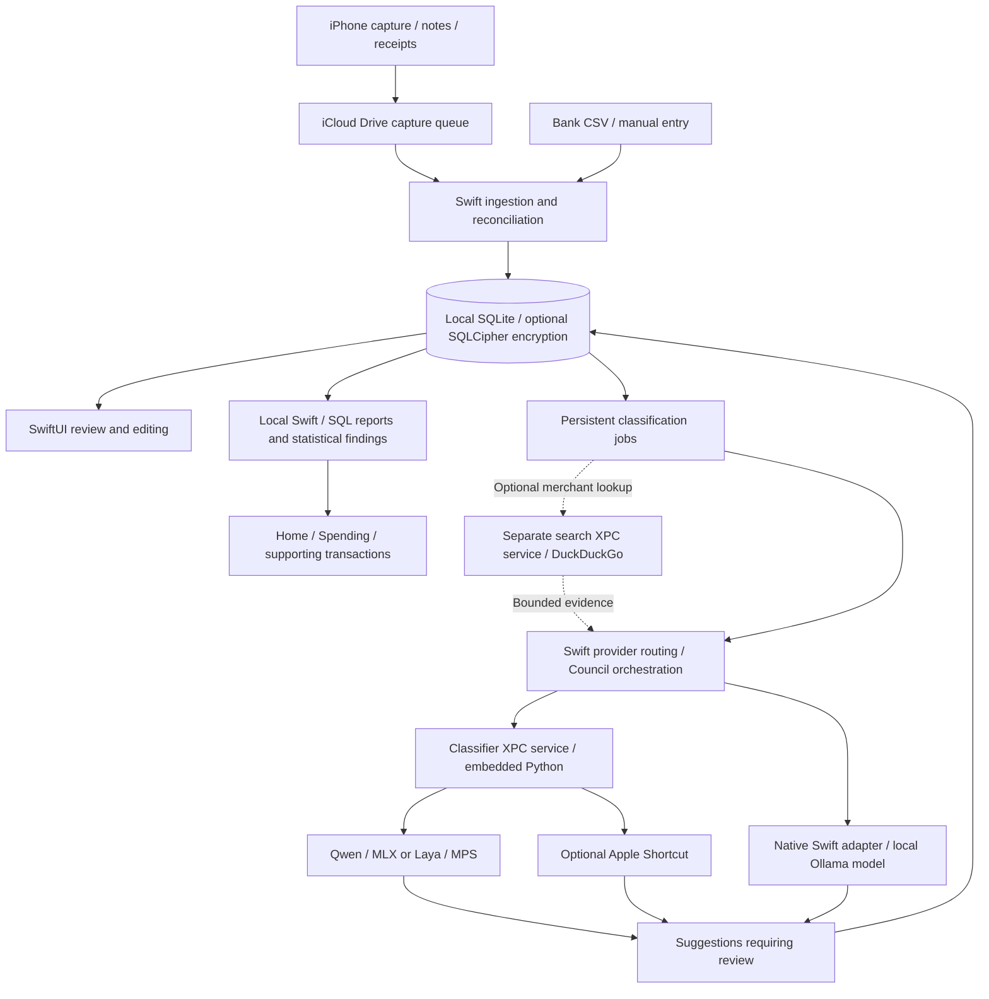

# GroundKeeper

GroundKeeper is a native macOS app for tracking and understanding personal
spending. Bring together iPhone captures, bank CSVs, and manual entries; review
category suggestions; and explore spending, repeated purchases, and changes
over time. Reports and statistical findings run locally in Swift and SQL,
without model calls.

Your ledger stays on your Mac, with optional passphrase encryption and no hosted
GroundKeeper backend or cloud AI required. Personal iCloud Drive delivers capture
files from iPhone to Mac. Optional DuckDuckGo merchant search and Apple
Intelligence providers use the data described in their explicit settings;
both can remain off.

iPhone Shortcuts capture transactions and pass them to your Mac through files in
your personal iCloud Drive, the only bridge between the two devices. Your Mac
processes each file and records its imported or quarantined status locally.
Successfully imported JSON and retained receipt images are removed from the
iCloud queue after durable vault storage and a content-hash check; quarantined
files stay for review. Saved delivery identities prevent repeated imports.
In the app, you can reconcile possible duplicates, correct details,
and confirm category suggestions while preserving the original capture evidence.

## Demo

A 74-second walkthrough of iPhone capture, receipt review, category suggestions,
and local spending insights.

https://github.com/user-attachments/assets/1c05f8a8-2805-4429-a71a-42f95de743aa

[View the full-quality MP4](docs/media/groundkeeper-demo.mp4).

## What you can do

- Add accounts in CAD, USD, EUR, or GBP and record transactions manually.
- Import a bank CSV, map its columns, and inspect every row before saving.
  Reopening the same file for the same account restores its mapping and resumes
  skipped rows. Mapping corrections and possible statement/capture matches
  require explicit review in Sync.
- Read captured transaction files from an iCloud Drive folder, resolve card
  labels to accounts, and review possible matches with existing transactions.
  Assign an account for one capture or explicitly remember its card for future
  imports. Settings lets you change or remove remembered mappings; Wallet and
  bank descriptions are mapped separately.
- Search, filter, edit, and soft-delete saved transactions. The transaction
  list loads 500 rows per page; search and filters apply to the current page.
- Click a transaction to view category review, notes, receipts,
  recorded location, and **Source & history**. Inspect original capture/statement
  facts and saved changes, or combine confirmed statement duplicates while
  preserving their evidence and counting the purchase once.
- See the current month's spending on Home and explore the complete ledger in
  **Spending**: purchases, refunds, net spending, counts, averages, largest
  purchases, category breakdowns, and charts with exact-value tables.
- Compare periods and filter reports by account, merchant, category, or existing
  tag. Use calendar, rolling, all-time, or custom ranges, with separate currencies
  and configurable reporting timezone and week start.
- See merchant spending and purchase frequency. Explicitly group statement names,
  undo grouping, or correct a single purchase's merchant without merging purchases.
- Inspect locally calculated spending changes, merchant concentration, weekly
  trends, sustained shifts, and unusually large merchant purchases. Findings
  explain their method and link to supporting transactions; dismiss them or
  snooze them for seven days.
- Run Qwen through MLX, Laya through PyTorch MPS, or an installed local
  **Ollama** model on your Mac. Ollama needs no GroundKeeper model package.
  Every category suggestion requires review, and later model replies cannot
  replace a confirmed correction.
- Use Model council to consult Qwen, Laya and Apple Intelligence with equal votes,
  saved member decisions and explicit handling of disagreements or missing providers.
  Every suggestion requires review.
- Capture optional notes and receipt OCR alongside a payment, or attach a receipt
  later. Review them in **Notes & receipts…** on the Mac. Keeping the image is
  optional; captured notes remain separate from editable transaction notes and
  are not sent to classifiers. See [receipt and note setup](shortcuts/README.md#optional-receipts-and-notes).
- Add receipt images from **Photos**, **Files…**, or **Take photo…** in the
  transaction editor; crop them and extract text locally. Save commits the entry
  and receipt changes together; Cancel discards staged changes. See the
  [transaction viewer and receipt editor](apps/macos/README.md#transaction-viewer-and-receipt-editing).
- Request **Suggest category** while editing, using the selected provider,
  editable notes, and available receipt text. **Use suggestion** accepts the
  proposed type/category; **Save transaction** saves the entry separately.
- Choose an ordinary local database or a passphrase-encrypted vault. Lock the
  encrypted vault, change its passphrase, or optionally enable convenience unlock
  in a provisioned build. See [vault protection](docs/onboarding.md#storage-and-unlock).
- Choose automatic processing while the app is open or run it manually with
  **Process queue**. Failed work has bounded retries and a visible review path.
  Closed-app background processing is available in source builds but disabled
  in the free release after macOS rejected an ad hoc update. Encrypted vaults
  require interactive unlock and cannot process work while the app is closed.

The native interface supports System, Light, and Dark appearances, Reduce Motion,
and a responsive Spending layout. See the [macOS guide](apps/macos/README.md)
for interface and processing details.

## Spending reports and findings

Reports query the full ledger independently of the 500-row transaction page.
Charts and supporting-transaction sheets preserve the selected scope; evidence
is paginated across all matching records. Merchant reports show distinct purchase
counts, repeats within the period, average purchase amounts, purchases per week,
active purchase days, and average gaps. Active days are not verified store visits.

Merchant identity conservatively normalizes statement names. Branch numbers,
punctuation, and processor prefixes remain significant; ambiguous generic names
stay unassigned. **Manage groups** lets you explicitly combine names under one
merchant for existing automatic matches and future imports, then undo that rule.
Per-purchase corrections survive later grouping changes. Models and web search
do not decide merchant identities, and grouping never deduplicates purchases.

Findings use deterministic rules and statistical tests over recorded history,
with adjustable sensitivity and **How this was found** explanations. Supporting
transactions include the actual analysis and baseline windows. Dismissals and
seven-day snoozes persist across refreshes; reporting preferences can restore
hidden findings. Ledger changes invalidate old results and trigger recalculation
when reports refresh.

Refunds reduce spending on their recorded date; transfers and card payments are
excluded. Valid mapped captures become actual transactions immediately, without
waiting for a CSV import. Unconfirmed categories remain provisional. Findings
require sufficient reviewed history and are suppressed by uncertain data in scope. Missing imports can affect
patterns, and an empty date does not establish zero spending. These reports do
not establish account completeness, causation, fraud, or future spending.
Budgets, subscription detection, forecasts, receipt analytics, and insight
notifications remain future work. See [spending reports and analysis rules](docs/spending-reports.md).

## Classification and optional services

Use a bundled local model, an installed Ollama model, an explicitly selected
Apple Intelligence Shortcut, or **Model council**. Council gives Qwen, Laya,
and Apple one vote each. Two matching valid type/category decisions produce a
suggestion; if the third provider fails, the result is visibly partial.
Without consensus, the current categorization
stays in place. Member decisions and failures remain inspectable, including
after a user correction. Every suggestion requires review. See [Council setup,
policy, and verification](docs/council.md).

If Ollama is already installed, open it and choose **Settings > Install models or
choose a provider > Ollama**. Refresh the model list, pick an installed chat or
instruction model, and click **Use Ollama model**. No GroundKeeper Qwen/Laya
download is required. The adapter connects only to Ollama on this Mac, excludes
cloud-backed models, and keeps every suggestion subject to review. See
[Ollama setup](docs/setup.md#ollama).

An optional Apple Intelligence Shortcut provider is also wired into the queue.
Enabling it sends the description, direction, currency, and available editable
transaction notes to the selected Shortcut. Its **Use Model** action controls
whether inference runs on device or in the cloud. Apple usage limits apply,
and the app never switches providers automatically. See
[provider setup and verification](docs/setup.md#choose-a-classifier).
Receipt text is shared with this provider only when **Include receipt text with
Apple Intelligence** is enabled; that separate setting is on by default.

Live Apple inference through the sandboxed app remains unverified in the latest
recorded checks. Qwen and Laya completed the native Council smoke check with
Apple recorded unavailable; successful live three-member inference has not been
demonstrated. See the [Apple availability limitation](docs/council.md#apple-availability-limitation).

Optional **DuckDuckGo merchant search** adds bounded business titles/snippets and
source URLs to Qwen, Laya, or Apple Intelligence inputs. It runs from the Mac,
sending cleaned merchant terms and optional city/region to DuckDuckGo. It is on
by default, caches evidence locally, and paces uncached searches roughly 11
seconds apart before model processing time. It requires internet access, uses no
API key or hosted GroundKeeper search backend, and never bypasses review.
Search consent also permits forwarding retrieved context to the selected Apple
Shortcut, which may process it in the cloud. Local Qwen/Laya inference stays
local. See [search setup](docs/setup.md#optional-duckduckgo-merchant-context).

Wallet captures can optionally supply a broad category hint as uncertain
supporting evidence; it never directly assigns a category or overrides explicit
purchase/receipt evidence. Configuring this requires category-filtered phone
automations; the standard adapter leaves it blank. See the [Wallet hint guide](shortcuts/README.md#optional-wallet-category-hint).

## How it works



Swift owns the database, imports, and job queue. It stores money as integer
minor units and keeps the original capture evidence separate from the
transaction you edit. Delivery identities prevent replayed files from creating
the same record again; possible purchase duplicates still require reconciliation.

A bundled Objective-C XPC host runs CPython and the inference libraries outside
the UI process. Local model packages have file hashes and a versioned manifest
that the worker checks before loading. The classifier receives the transaction
description, direction, currency, and authorized optional evidence: editable
transaction notes, bounded receipt OCR, a Wallet category hint, and merchant-search
snippets. Receipt images and captured notes are not sent to the classifier.
It has no database connection. Ollama uses a native Swift adapter to contact the
separately running local service. Swift orchestrates Council and records member
inputs and outcomes.
Merchant search uses a separate network-enabled XPC service; reporting and
statistical analysis run locally without inference or search requests.

iCloud transfers capture files. The live database stays in the Mac's sandbox
container, outside iCloud Drive. SQLCipher opens an ordinary SQLite database
without a key, or encrypts the database and WAL with a passphrase. Provisioned
builds can optionally store the passphrase in a device-local Keychain item,
requiring Touch ID or the Mac password to retrieve it. Free ad hoc builds retain
passphrase encryption but hide convenience unlock. Local encryption does not
encrypt source captures or images while they are in iCloud. There is no passphrase
recovery service, bank login integration, or native iPhone app.

## Install a release

Pushes to `main` are configured to build an ad hoc-signed macOS prerelease
with the Python worker included. Each release also carries the selected Qwen
and Laya model packages, available Shortcut exports, and setup instructions.
Models are separate downloads so the app can be installed without them.

See the [installation guide](docs/install.md) for the download and model setup
steps. Release publication needs the one-time [maintainer setup](docs/releases.md)
for model assets. No paid Apple membership or signing credentials are required.
Downloaded builds need the macOS **Open Anyway** step described in the guide.

## Build and try it

The full app requires an Apple silicon Mac, macOS 26.2 or later, full Xcode,
and [uv](https://docs.astral.sh/uv/getting-started/installation/).
The bundled runtime pins CPython 3.12.9. Xcode 27.0 is the locally verified
toolchain. Installers and model archives are distributed through GitHub Releases;
large generated binaries are kept out of the source repository.

From a terminal with Xcode selected as the developer directory:

```sh
git clone https://github.com/Henry-The-Yang-101/GroundKeeper.git
cd GroundKeeper

uv sync --locked --python 3.12.9
uv venv --python .venv/bin/python .local/laya/.venv
uv pip install --python .local/laya/.venv/bin/python -r experiments/laya/requirements.lock
uv venv --python .venv/bin/python .local/merchant-search-ddgs/venv
uv pip install --python .local/merchant-search-ddgs/venv/bin/python -r experiments/merchant-search/requirements.txt

./apps/macos/run.sh
```

The first setup downloads Python and dependencies as needed. The launcher
packages the pinned Python runtime, builds the app with Xcode, and opens it.
All three Python environments (main, Laya, and DDGS) are required by the current
bundle, even for manual entries or with merchant search disabled. Model weights
are separate.

On first launch, the setup assistant walks through vault protection, optional
models, a capture folder, phone setup, and an account. Progress survives relaunch,
and model/capture setup can be skipped. The assistant and Settings offer local
model installation from the pinned catalog, with archive and package verification.
See [onboarding and protection](docs/onboarding.md).

For a first exercise, add a fictional CAD account during setup or in Settings,
then import [`examples/transactions.csv`](examples/transactions.csv) from Sync. The
[sample walkthrough](examples/README.md) gives the column mapping and a short
editing exercise. You can try this workflow without a model or iCloud connection;
the sample records are saved in the app's normal local database.

For an isolated spending walkthrough with automatically calculated insights, run
`./apps/macos/run-demo.sh`. It builds and opens a fresh temporary vault with about
600 imported fictional transactions. Use `--no-build` to reuse the Debug app;
see the [demo guide](apps/macos/README.md#fictional-spending-demo) for details.
For separately identified concurrent demos, use `--instance NAME` with a locally
signed Debug build. The named copy is for fictional UI work; it does not validate
live Keychain or classifier XPC behavior.

For phone capture, install the shared writer before its Wallet or experimental
CIBC adapter, set the inbox/assets destinations, and configure personal
automations on the receiving phone. Adapter success notifications confirm the
capture file was saved, not that iCloud uploaded it or the Mac imported it.
Real Wallet triggers, locked-phone behavior, and CIBC triggering still require
device verification. See [iPhone setup](shortcuts/README.md#iphone-capture-setup).

See the [setup guide](docs/setup.md) for Xcode selection, signing, local model
packages, Apple Shortcuts, capture setup, and troubleshooting.

## Development and tests

The Swift core can be tested separately from the app and its ML runtime:

```sh
swift test --package-path apps/macos/GroundKeeperCore --scratch-path .local/macos/CoreBuild
```

After installing the Python project dependencies on Apple silicon:

```sh
.venv/bin/python -m pytest -q
```

These tests cover parsing, database constraints and migrations, encryption,
reconciliation, receipts, full-ledger reporting, merchant identities and grouping,
statistical patterns, Council, merchant search, classification contracts, and
experiment utilities. Model inference and signed background
execution have separate [app smoke checks](apps/macos/README.md#verification).
After building Debug, `./scripts/check_spending_demo.sh` checks the fictional
fixture and calculated reports in disposable vaults, including reconciliation,
repeatable findings, and date boundaries. Recorded test and UI results, with
their limits, are in the [spending guide](docs/spending-reports.md#verification)
and [Council guide](docs/council.md). Fictional-data checks do not establish
real-history detector precision or physical-iPhone behavior.
Benchmark reports distinguish synthetic or AI-labeled agreement from accuracy
against independently reviewed transactions.

[CI](.github/workflows/tests.yml) runs the standalone Swift core on macOS and
the Python schema and classifier-contract tests on Linux. It does not download
models or exercise GPU inference, iCloud, or signed app services.

## Repository guide

| Path | Contents |
| --- | --- |
| [`apps/macos/`](apps/macos/README.md) | SwiftUI app, classifier/search XPC services, Swift ledger and analysis core, and native tests |
| [`groundkeeper/`](groundkeeper/) | Python classifier worker, policy, constrained decoding, receipt helpers, and merchant search |
| [`contracts/`](contracts/) | Database schema, capture formats, classifier protocol, and runtime pins |
| [`docs/`](docs/README.md) | Installation, onboarding, spending reports, Council, category policy, and roadmaps |
| [`shortcuts/`](shortcuts/README.md) | Capture, receipt/OCR, and Apple Intelligence exports, editable sources, and phone setup |
| [`release/`](release/) | Pinned model catalog, notices, and release notes |
| [`examples/`](examples/README.md) | Fictional data for trying CSV import |
| [`tests/`](tests/) | Python unit tests |
| [`scripts/`](scripts/) | Runtime/release packaging, demo verification, dataset preparation, training, and evaluation tools |
| [`experiments/`](experiments/) | Experiment configurations, annotations, and measured results |
| [`research/`](research/) | Dataset investigations and earlier feasibility work |

Generated models, environments, checkpoints, and build output belong in ignored
local directories. Private financial fixtures belong in `.private/` and must stay
out of commits. The [roadmap](docs/roadmap.md) describes remaining product work;
the [database implementation](contracts/database/IMPLEMENTATION.md) describes
current behavior and its limits.
