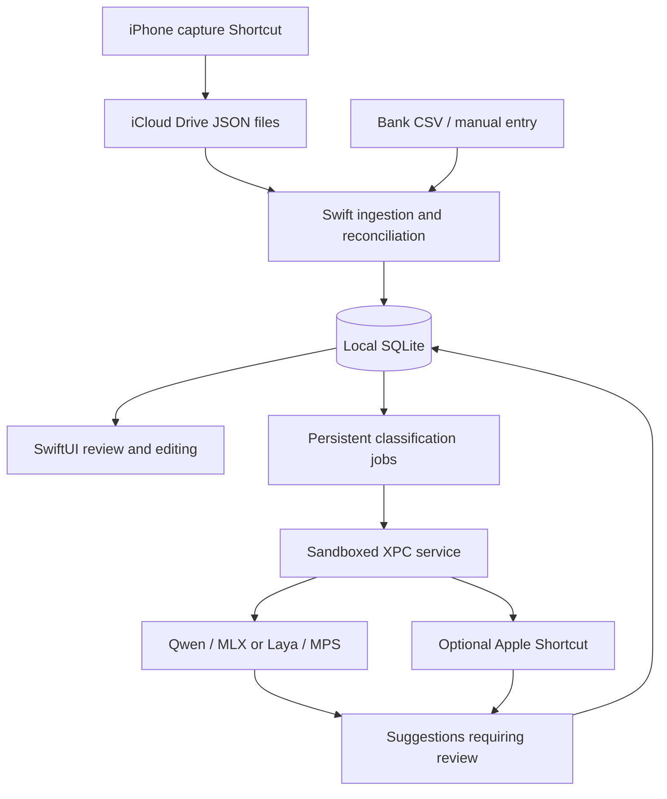

# GroundKeeper

The "GROUND" in GroundKeeper means your finances stay grounded on your own
devices: no hosted backend and no cloud AI required. Your personal iCloud Drive
simply delivers capture files from iPhone to Mac.

GroundKeeper is a local-first system designed to automatically help you keep track of personal spending. The end-to-end system lies strictly within your own personal environment, with no external cloud server ever getting hands on your private transaction data. YOU are fully in control of your own private data.

iPhone Shortcuts capture transactions and pass them to your Mac through files in
your personal iCloud Drive, the only bridge between the two devices. Your Mac
processes each file, saves the transaction locally, and removes the file from the
transfer queue. Captures join imported bank statements and manual entries in a
local SQLite database that stays on your Mac, where you can review possible
duplicates, correct details, and confirm category suggestions.

## What you can do

- Add accounts in CAD, USD, EUR, or GBP and record transactions manually.
- Import a bank CSV, map its columns, and inspect invalid rows before saving.
- Read captured transaction files from an iCloud Drive folder, resolve card
  labels to accounts, and review possible matches with existing transactions.
- Search, filter, edit, and soft-delete saved transactions. The transaction
  list loads 500 rows per page; search and filters apply to the current page.
- Run Qwen through MLX or Laya through PyTorch MPS on your Mac. Every category
  suggestion requires review, and later model replies cannot replace a
  confirmed correction.
- Optionally enrich classification with OCR text from a receipt photo, giving
  the selected model purchased-item context beyond the merchant name. Keeping
  the image is optional. See [receipt capture setup](shortcuts/README.md#optional-receipts).
- Choose automatic processing while the app is open or run it manually with
  **Process queue**. Failed work has bounded retries and a visible review path.
  Closed-app background processing is available in source builds but disabled
  in the free release after macOS rejected an ad hoc update.

An optional Apple Intelligence Shortcut provider is also wired into the queue.
Enabling it sends the description, direction, and currency to the selected
Shortcut. Its **Use Model** action controls whether inference runs on device
or in the cloud. Apple usage limits apply, and the app never switches providers
automatically. See [provider setup and verification](docs/setup.md#choose-a-classifier).
Receipt text is shared with this provider only when **Include receipt text with
Apple Intelligence** is enabled; that separate setting is off by default.

## How it works



Swift owns the database, imports, and job queue. It stores money as integer
minor units and keeps the original capture evidence separate from the
transaction you edit. Delivery identities prevent replayed files from creating
the same record again; possible purchase duplicates still require reconciliation.

A bundled Objective-C XPC host runs CPython and the inference libraries outside
the UI process. Local model packages have file hashes and a versioned manifest
that the worker checks before loading. The classifier receives the transaction
description, direction, currency, and optional bounded receipt OCR context.
Receipt images are not sent to the classifier. It has no database connection.

iCloud transfers capture files. The live database stays in the Mac's sandbox
container, outside iCloud Drive, and currently uses ordinary, unencrypted SQLite.
The repository contains no bank login integration or native iPhone app.

## Install a release

Pushes to `main` are configured to build an ad hoc-signed macOS prerelease
with the Python worker included. Each release also carries the selected Qwen
and Laya model packages, available Shortcut exports, and setup instructions.
Models are separate downloads so the app can be installed without them.

See the [installation guide](docs/install.md) for the download and model setup
steps. Release publication needs the one-time [maintainer setup](docs/releases.md)
for model assets. No paid Apple membership or signing credentials are required.
Downloaded builds need the macOS **Open Anyway** step described in the guide.

## Build and try it

The full app requires an Apple silicon Mac, macOS 26.2 or later, full Xcode,
and [uv](https://docs.astral.sh/uv/getting-started/installation/).
The bundled runtime pins CPython 3.12.9. Xcode 27.0 is the locally verified
toolchain. Installers and model archives are distributed through GitHub Releases;
large generated binaries are kept out of the source repository.

From a terminal with Xcode selected as the developer directory:

```sh
git clone https://github.com/Henry-The-Yang-101/GroundKeeper.git
cd GroundKeeper

uv sync --locked --python 3.12.9
uv venv --python .venv/bin/python .local/laya/.venv
uv pip install --python .local/laya/.venv/bin/python -r experiments/laya/requirements.lock

./apps/macos/run.sh
```

The first setup downloads Python and dependencies as needed. The launcher
packages the pinned Python runtime, builds the app with Xcode, and opens it.
Both Python environments are required by the current bundle, even if you only
want to try manual entries or CSV import. Model weights are separate.

For a first run, add a fictional CAD account in Settings and import
[`examples/transactions.csv`](examples/transactions.csv) from Sync. The
[sample walkthrough](examples/README.md) gives the column mapping and a short
editing exercise. You can try this workflow without a model or iCloud connection;
the sample records are saved in the app's normal local database.

See the [setup guide](docs/setup.md) for Xcode selection, signing, local model
packages, Apple Shortcuts, capture setup, and troubleshooting.

## Development and tests

The Swift core can be tested separately from the app and its ML runtime:

```sh
swift test --package-path apps/macos/GroundKeeperCore --scratch-path .local/macos/CoreBuild
```

After installing the Python project dependencies on Apple silicon:

```sh
.venv/bin/python -m pytest -q
```

These tests cover parsing, database constraints, reconciliation, classification
contracts, and experiment utilities. Model inference and signed background
execution have separate [app smoke checks](apps/macos/README.md#verification).
Benchmark reports distinguish synthetic or AI-labeled agreement from accuracy
against independently reviewed transactions.

[CI](.github/workflows/tests.yml) runs the standalone Swift core on macOS and
the Python schema and classifier-contract tests on Linux. It does not download
models or exercise GPU inference, iCloud, or signed app services.

## Repository guide

| Path | Contents |
| --- | --- |
| [`apps/macos/`](apps/macos/README.md) | SwiftUI app, XPC service, Swift core, and native tests |
| [`groundkeeper/`](groundkeeper/) | Python classifier worker, policy, constrained decoding, and merchant utilities |
| [`contracts/`](contracts/) | Database schema, classifier protocol, and runtime pins |
| [`docs/`](docs/README.md) | Setup, roadmap, category policy, and historical notes |
| [`shortcuts/`](shortcuts/README.md) | Apple Intelligence exports and capture setup |
| [`release/`](release/) | Pinned model catalog, notices, and release notes |
| [`examples/`](examples/README.md) | Fictional data for trying CSV import |
| [`tests/`](tests/) | Python unit tests |
| [`scripts/`](scripts/) | Runtime packaging, dataset preparation, training, and evaluation tools |
| [`experiments/`](experiments/) | Experiment configurations, annotations, and measured results |
| [`research/`](research/) | Dataset investigations and earlier feasibility work |

Generated models, environments, checkpoints, and build output belong in ignored
local directories. Private financial fixtures belong in `.private/` and must stay
out of commits. The [roadmap](docs/roadmap.md) describes remaining product work;
the [database implementation](contracts/database/IMPLEMENTATION.md) describes
current behavior and its limits.
