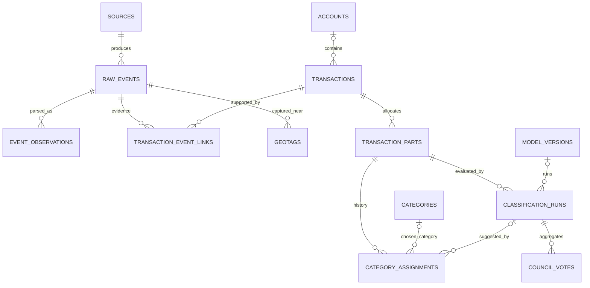

# GroundKeeper database design

Design date: 2026-10-17. Companion DDL: [schema.sql](schema.sql).

This is a proposed, executable schema for a **single local vault on one Mac**.
It covers the current product plan, including later planning/analysis modules.
It does not install a database, migrate the experiments, or connect the SwiftUI
preview. Build the core first; leave later tables unused until their features
ship. There is no server, login system, native iPhone database, or live SQLite
file in iCloud. Multiple independent vaults use separate files.

## The central model

One transaction is an account-side economic record. Several raw events can
describe it. A transaction always has one or more monetary parts. Each part has
an append-only category/type assignment history and one current assignment.



Wallet capture + bank notification + posted CSV row normally become **three
source events linked to one transaction**, not three purchases. A transfer
between two owned accounts remains two account-side transactions linked as
counterparts; neither contributes to spending. This is a tracker, not a complete
double-entry ledger or investment-lot accounting system.

## Conventions and connection setup

- IDs are app-generated opaque UUID text, except stable seeded taxonomy codes.
  Generate phone event UUIDs once per capture and preserve them through retries.
  Display names are never identity keys. New category IDs need not equal codes.
- All `*_at_ms`, `*_until_ms`, `*_from_ms`, `as_of_ms` timestamps are integer UTC
  Unix milliseconds. `*_on` fields are validated `YYYY-MM-DD` civil dates.
  Store original offset minutes and, if actually known, an IANA timezone.
  Validate calendar dates, DST conversions, ranges and JSON shapes in services.
- `occurred_at_ms` is purchase time when known; `captured_at_ms` is phone capture
  time; `received_at_ms` is Mac ingestion time; `posted_on` is settlement date.
  Never substitute arrival time for a known purchase timestamp. Date-only CSV
  rows have no invented midnight instant. For `time_precision='unknown'`,
  `occurred_on` is an explicitly provisional reporting date and needs review.
- Money is signed 64-bit integer minor units, using `currencies.minor_units`:
  CAD 12.34 = 1234. Negative means debit/outflow, positive means credit/inflow,
  independently of transaction type. A card purchase is negative; a payment
  credited to the card is positive. Don't use floating point for money.
  Zero-value status events need not become monetary transactions.
- A transaction's amount/currency is its account-side amount. Optional original
  amount/currency preserves the purchase-side amount for FX. Raw observations
  preserve every authorization/settlement amount, including tips and holds.
  Parts always use the parent's account currency. Cross-currency counterpart
  transactions retain their respective currencies; never require equal integers.
- `balance_snapshots.balance_minor` uses signed net-worth value: asset positive,
  liability owed negative. Available credit is separate from balance and never
  added to net worth. Snapshot corrections append a superseding row.
- JSON is for source payloads, versioned configuration, audit snapshots and
  calculated evidence. Monetary, category, account, time and ownership joins use
  typed columns/FKs. Validate versioned JSON schemas before writes.
- Use a pinned SQLCipher build with SQLite >= 3.37 and JSON functions. Key the
  connection **before** accessing its schema, verify the cipher is present and
  the key works, then enable/check `foreign_keys=ON` on **every** connection.
  Use a bounded busy timeout, WAL on local disk and controlled writer access;
  choose durability settings with recovery tests. `STRICT` rejects incompatible
  values but does not replace domain validation.
- Run migrations in transactions with checksums and backup/restore gates. The
  DDL is a first-schema fixture and intentionally has no fake applied-migration
  row. A real runner records version/checksum/time after successful application.
  Do not execute it over an existing vault or a merchant-experiment database.

## Table map

| Area | Tables | What they retain |
| --- | --- | --- |
| Vault/reference | `schema_migrations`, `currencies`, `app_settings`, `devices` | Schema history, currency precision, reporting timezone/week start, device identity and versioned settings. No unlock secrets in settings. |
| Sources/accounts | `sources`, `accounts`, `payment_instruments`, `source_account_mappings` | Capture channel/app/device; account currency/kind; physical/Wallet instruments; confirmed, dated source-to-account mappings. |
| Taxonomy | `categories`, `transaction_types`, `policy_versions` | Expandable category rows/hierarchy, type/category rules, frozen policy definitions. |
| Providers | `model_versions`, `model_categories`, `council_configs`, `council_config_members` | Exact local model/adapter/runtime identity, available model labels, immutable Council configuration and member weights. |
| Merchant memory | `merchants`, `merchant_aliases`, `user_rules` | Confirmed identities/aliases and explicitly authorized, versioned categorization rules. A chain and a branch can have different identities. |
| Capture evidence | `raw_events`, `raw_event_payloads`, `event_receipts`, `event_observations`, `geotags` | Stable capture identity, retention-controlled raw JSON, deliveries, versioned parse results and optional location samples. |
| CSV | `import_profiles`, `import_batches`, `import_rows` | Mapping/date/sign/decimal settings, exact batch mapping snapshots, row validation/provenance, skip/reject/undo state. |
| Transactions | `transactions`, `transaction_parts`, `category_assignments` | Canonical fields, allocations/splits, complete category/type selection history. |
| Classifier evidence | `classification_runs`, `council_votes` | Each attempt, input revision/hash, policy/model, typed output/review, latency/status and every Council participant/failure. |
| Reconciliation | `transaction_event_links`, `external_transaction_refs`, `reconciliation_decisions`, `transaction_relationships` | Current/historical evidence links, trusted source IDs, merge/not-duplicate decisions, refunds/transfers/payments/reversals. |
| User workflow | `tags`, `transaction_tags`, `part_tags`, `review_items`, `change_log` | Orthogonal labels, independent review reasons and grouped, auditable field edits. |
| Budgeting | `budgets`, `budget_versions`, `budget_filters` | Effective-dated limits/currency/period/rollover and category/account/tag scopes. |
| Goals | `goals`, `goal_movements` | Explicit targets and funding/allocation/withdrawal history, optionally linked to actual transactions. |
| Recurrence | `recurring_schedules`, `recurring_occurrences` | Suggested/confirmed cadence, expected dates/amounts, matched actual transactions and skipped/missed occurrences. |
| Balances/debt/FX | `balance_snapshots`, `debt_terms`, `fx_rates` | Dated account valuations, effective debt assumptions, exact rational FX observations/provenance. |
| Insights | `insight_preferences`, `insights`, `insight_evidence`, `insight_notifications` | Merchant thresholds, calculated metrics/baselines/caveats, evidence revisions, optional narrative model, dismissal/snooze, notification deduplication. |
| Operations | `processing_runs`, `queue_items`, `staging_keys`, `backup_records` | Worker/import status, retries/quarantine, staging-key rotation and verified backup inventory. |

## Optional transaction geotags

The iPhone capture Shortcut attempts **one current-location sample at capture
time**, puts it into the versioned iCloud event, and records location status.
Suggested event field (this extends the planned envelope; it is not a claim that
the capture Shortcut is already implemented):

```json
{
  "event_id": "<stable UUID>",
  "source": "apple_wallet",
  "captured_at": "2026-10-17T15:42:10-04:00",
  "location_status": "available",
  "location": {
    "latitude": 43.47,
    "longitude": -80.54,
    "measured_at": "2026-10-17T15:42:09-04:00",
    "horizontal_accuracy_m": 25
  }
}
```

Coordinates above are fictional coarse examples. Location is optional: denied
permission, unavailable GPS, timeout or a locked-phone restriction must not lose
the transaction. Use `location:null` and the explicit status. Bound location
acquisition time; do not make capture wait indefinitely or substitute `(0,0)`.
Verify the actual Shortcuts fields/actions on-device before freezing the schema
of the envelope; omit unavailable accuracy rather than inventing it.

`geotags` stores latitude/longitude, measurement time, optional horizontal
accuracy and origin. Event-owned samples preserve original capture evidence;
user pins belong directly to a transaction. `transactions.selected_geotag_id`
selects one optional display sample. Linking a second capture never silently
overwrites the first. Prefer a sufficiently fresh Wallet-time sample over a
delayed bank-alert location, retain both candidates, and allow user correction.
Display “phone location at capture” unless evidence supports purchase location.
Geotags are not merchant identity, purchase purpose or sufficient duplicate proof.

The classifier input stays `description/direction/currency`; location is excluded
from local/cloud classification and Council by default. Location data lives
inside the encrypted vault after ingestion but also exists in the capture JSON
in iCloud before ingestion. Provide capture opt-out, location removal/retention
and explicit backup behavior. A purge must remove selected pointers, geotags,
raw/import payload copies and queued/staged copies containing location; already
exported/backed-up copies need their own retention/expiry policy. A hash is not
an anonymized replacement for sensitive data.

## Category provenance and future categories

Categories are rows, not an SQL enum or Swift-only list. Seed 18 named categories
plus Other and Uncategorized. Stable IDs/codes survive renames. New categories
and optional subcategories are inserts; archive instead of deleting referenced
categories. `parent_id` supports hierarchy with a cycle guard. Explicit category
merges set `replaced_by_id`, with a user-approved reassignment operation/history;
do not rewrite historical selections just because a replacement exists.
Services also prevent replacement cycles and changes to reserved fallback kinds.

Each transaction has a single `transaction_part` initially. Split a mixed
purchase into several parts when supported. Parts carry their own amount and
current assignment. There is no conflicting second category on the parent.

`category_assignments` records both **type and category**, selection time,
origin (`user`, `model`, `council`, `rule`, `import`, `system`), review target,
optional user confirmation and the superseded assignment. The origin describes
the actual mechanism, not whether someone eventually approved its result.

Examples:

| UI state | Stored history/current choice |
| --- | --- |
| AI suggestion: Dining · Qwen | `origin=model`, `run_id` → Qwen model/revision/adapter; no confirmation. |
| AI suggestion: Dining · Council | `origin=council`, `run_id` → Council configuration, votes, participating exact models, failed/skipped members and final decision. |
| User accepts that suggestion | Append `origin=user`, same type/category, confirmation time/actor, `supersedes_id` → AI assignment; original run stays inspectable. |
| User changes Dining to Groceries | Append a confirmed user assignment; old category/model remain in history. |
| Explicit merchant rule applies | `origin=rule`, versioned `rule_id`; show rule provenance. It is not a fresh manual decision or an AI call. |
| CSV supplied a category | `origin=import`, `import_row_id`; imported labels are not automatically user-confirmed. |
| No supported decision | `origin=system`, `unknown/uncategorized`, review required. |

The database checks that AI/Council assignments refer to a successful run for the
same part, method, type and category. Model identity is reached through that
run, avoiding an independent model-name string that can disagree with provenance.
An app query can display `model_versions.provider/model_name/revision` or
`Council` plus its config and members. Confirmation appends a new assignment,
then atomically switches `current_assignment_id`. Confirmed choices cannot be
silently replaced by model/rule/import suggestions. New runs may still be saved.

Each `classification_run` records the transaction revision and a frozen input,
policy and configuration. Council has a parent run and provider child runs;
`council_votes` retains expected members/weights even when no request succeeded.
Don't claim a cloud service revision is pinned when it is unavailable; record
known settings and observed service version instead. Do not store invented
confidence percentages. Separate model `needs_review` from independent open
review reasons such as duplicate, missing amount or account uncertainty.

Database category extensibility does **not** make old models understand new
labels. `model_categories` maps each frozen model's supported outputs to stable
category IDs. Update Swift vocabulary, prompts, validators/grammar, policy and
evaluation deliberately. Until supported, new categories are manual/rule choices
or receive an explicit mapped broader AI suggestion. Existing experimental
`groundkeeper/policy.py` remains frozen; it is not dynamically backed by this DDL.

## Sources, duplicate delivery and reconciliation

The transaction has a **set of sources**, exposed by
`transaction_source_summary`, rather than a single `source='wallet'` field that
loses the later bank/CSV provenance. Source instances retain channel, device and
bank/app identity. Payment instruments map Wallet/device account numbers to the
actual account. Last four digits are hints, never global unique identifiers.
Use validity intervals for card replacements; don't collect full PANs.

Three different problems have different keys:

1. **Delivery replay:** `(source_id, source_event_id)` uniquely identifies one
   capture. The same UUID and hash is an idempotent replay; store/reuse its
   receipt without a new purchase. The same UUID with different content is an
   identity collision: quarantine and review, never overwrite original evidence.
   Content hashes detect transport changes; identical text/amount/hash under two
   different capture IDs can represent two legitimate purchases and is not unique.
2. **Repeated source record:** when a bank/export provides a reliable identifier,
   `external_transaction_refs` uniquely maps its source/account/namespace/record
   ID to a canonical transaction. Authorization and settlement namespaces can
   differ; only observed provider contracts justify treating them as identical.
   Source instances across devices need a shared trusted namespace or explicit
   cross-source matching; device-generated IDs are not bank transaction IDs.
3. **Cross-source observations:** match Wallet/bank/CSV/manual evidence using
   account/card mapping, currency, amount, merchant and time precision. These
   fields generate candidates, not a UNIQUE constraint. Location can support a
   review but cannot establish identity. CSV date-only records use date windows,
   not an invented timestamp. Near matches, FX, tips and holds require evidence
   or review; never assume all bank alerts are posted transactions.

Example: Wallet event `w1` reports a CAD 12.50 purchase at 10:03, with a phone
location. Bank event `b1` arrives at 10:05 for the same card, amount and merchant.
Create transaction `t1` with one part for -1250 CAD, and active links from both
events. A later statement row links as settlement evidence; preserve the bank
amount/time and the Wallet location. Spending counts the one part once. A second
Wallet tap `w2` for CAD 12.50 is a new purchase; it cannot disappear because its
amount or merchant matches `w1`. Pair candidate bank events one-to-one in time
order, and review ties that available evidence cannot distinguish.

`one_current_transaction_per_event` prevents an event being active evidence for
two transactions. It does **not** limit a transaction to two events: multiple
bank lifecycle updates are valid. The service must ensure distinct Wallet
purchase identities are not collapsed into the same canonical transaction.
Reconcile against existing and newly arrived events in both arrival orders.
Lock the consuming writer and run linking/merging in one SQL transaction.

`reconciliation_decisions` stores user/system action, evidence, algorithm version
and supersession. An explicit `not_duplicate` blocks repeat proposals for that
pair until deliberately reversed. On merge, retain the losing transaction as
`state=merged`, reroute active links/external refs to the survivor and preserve
before/after snapshots. Never delete evidence or automatically combine two
confirmed conflicting allocations. Unmerge restores the saved link/field state,
respecting subsequent user edits; review conflicts rather than overwriting them.
Clear/reselect event-backed geotags whenever unlinking their supporting event.

Refunds, reversals, reimbursements and transfer/card-payment counterparts are
relationships, not duplicate merges. Allocate partial refunds against the
original transaction with amounts/currency; a refund can reference several
purchases. Services check cumulative allocations, original eligibility and
currency. Expenses/refunds determine spending; income/transfers/payments do not.

## Splits, review and user edits

Every active transaction has parts summing exactly to its signed amount and a
valid current assignment for every part. A CAD 50 purchase split -3000 groceries
and -2000 shopping counts once as 5000 spending. A mortgage with independently
known principal/interest uses loan-principal and expense parts; do not invent
the allocation from an unsplit statement label. The schema need not invent a
new `mixed` model type for the parent.

To change split amounts: `BEGIN IMMEDIATE`, make the transaction draft, update
parts and assignments, validate, activate, write audit/revision/invalidation,
then commit. On failure roll back the entire operation. Drafts are excluded
from reports and must never leak as a committed partial edit. SQL activation
checks totals and required selections. Optimistic updates use
`WHERE id=? AND revision=?`; reject stale UI/worker writes and increment revision.

Write field-level provenance in `transactions.field_provenance_json`, e.g.
`amount -> observation b1:v1`, `time -> observation w1:v1`, `description -> user
operation X`. `change_log` stores before/after snapshots grouped by operation.
JSON references are service-validated; they are not foreign keys. Keep user
overrides sticky when refreshing parsers or settlement information. Correcting
a category never creates a merchant rule without a separate explicit action.

`review_items` can hold several unresolved reasons simultaneously. Approving a
category resolves its reason only. Amount/account/duplicate/location issues
stay open. Unknown/Uncategorized and unassigned refunds require category review.
The current views expose suggested category, confirmation and independent review
flags so the UI can distinguish provisional and confirmed totals.

CSV commit is atomic after row validation/preview. A batch is scoped by source,
account and file hash; identical bytes reuse the existing batch, even with a
different filename. Mapping snapshots make the interpretation reproducible.
For a multi-account CSV, the batch account scope is null and parsed rows supply
their individual accounts; a separate partial unique index prevents duplicate
multi-account batches. Missing row accounts need an explicit default or review.
Revising a mapping reprocesses the same batch in a controlled operation; do not
discard its first provenance. Different overlapping exports reconcile source IDs
and candidates rather than relying on a file hash alone.

Undo marks the batch/rows undone and removes its active evidence links. A
transaction supported only by that batch may become deleted, but retain it if
other captures, later manual edits or confirmed choices depend on it. Recompute
canonical fields from remaining evidence; ask for review where user work would
be lost. Undo is not `DELETE ... CASCADE`. Reimporting an undone batch explicitly
reactivates it, using the same stable batch/row/event identities.

## Reporting and later feature modules

- `current_transaction_parts` is the allocation-level active view.
  `spending_entries` includes **posted** expense/refund parts and emits positive
  expenses/negative refunds. It intentionally exposes provisional categories
  and review flags: callers must label/filter them. Pending spending is a
  separate visible projection. Never total a join to source events or tags
  without preaggregation/EXISTS; it would multiply purchases. `abs` in the view
  assumes the service validated type/direction; a mislabeled debit refund needs
  review, not silent sign repair. Unknown types are shown separately.
- Query by the user's reporting timezone, using real instants where available
  and source civil dates where only dates are known. `occurred_on` is the source
  civil date, not automatically the reporting date in every timezone. Generate
  UTC boundaries for instant queries; handle date-only records explicitly.
  Add an instant-date index when those queries ship. Period intervals are
  half-open; keep currencies separate. Show counts at transaction grain and
  category amounts at part grain.
- Budget versions use nonoverlapping effective periods and OR within a filter
  dimension / AND across dimensions. Empty filters mean all; descendants are
  opt-in in the versioned scope config. `scope_json` defines policy (including
  custom-period anchor and descendant behavior); filter rows define membership.
  Rollover is calculated from historical versions and actual spending, not a
  mutable balance that drifts. Shared/tag budgets never multiply spending.
- Goals have either allocation or contribution funding. Movement signs and
  kind must agree; services enforce method, currency, account availability,
  reversal identity and no double allocation of the same funds across goals.
  These are planning records, not extra bank expenses/income. Preserve goal
  target edits in the operation log; introduce effective target versions if
  historical target-pace charts ship.
- Recurring schedules are expectations and never create actual spending.
  Occurrences snapshot expected price and link observed transactions; schedule
  edits are audited. A frequent café merchant isn't automatically a subscription.
- Balance snapshots are actual dated observations; derived values are labeled.
  Never extrapolate transaction capture into complete net worth. FX rates use
  rational values and explicit date/source; calculations use decimal/rational
  arithmetic with explicit rounding. No automatic mixed-currency summation.
- Insights hold calculated metrics, period/baseline/currency, caveats and rule/
  data version. Evidence links retain transaction revisions. A global
  `data_revision` setting increments after imports/edits/undo; stale findings
  are invalidated and regenerated. Preserve dismissal/snooze across regeneration
  by fingerprint/history. Optional narrative provider is recorded separately
  from transaction classification. Notifications require opt-in and a stable
  delivery key. Extra evidence IDs for budgets/goals/balances belong in the
  versioned metrics JSON until those detectors get typed evidence tables.

## Storage, staging, retention and performance

Keep the live vault, WAL/SHM and models outside iCloud. Swift services own the
unlocked database and migrations; classifier workers receive minimized inputs,
never an unlocked connection or database key. The old experimental
`MerchantMemory` tables are not production migrations; adapt that API explicitly
to these merchant/rule/assignment tables when connecting the app.

The staging **private** keys live only in the encrypted `staging_keys` table.
Export public keys separately for the locked worker. Retain retired private
keys until all old envelopes are imported or deliberately retired. Password/
Touch ID/recovery keyslots must live in a small authenticated, versioned sidecar
or Keychain because a locked database cannot supply its own unlock key. The
sidecar contains wrapped keys/KDF parameters, never plaintext secrets; the vault
identifier and recovery format must be independently restorable. Do not invent
production cryptography from this relational design.

A locked worker cannot update this database's `queue_items` or `processing_runs`.
It uses atomic sealed files plus a minimal content-free local operational
journal; unlocked import ingests their receipts/status into these tables.
Delete input files only after verified durable sealed staging, and acknowledge
staging only after committed vault import. Stable event IDs make either crash
replay safe. Queue hashes aren't unique transaction identifiers.

Backups use a consistent database snapshot plus version-compatible keyslots,
not a copy of a running SQLite file. Store only completed encrypted backups in
iCloud. `backup_records` is a local catalog, not the only restore manifest;
each backup carries an authenticated self-contained manifest outside the vault.
Test wrong-key, missing-keyslot, interrupted import, key rotation and fresh-device
restore with SQLCipher before release. No encryption is established by executing
this schema with Python's ordinary `sqlite3`.

Raw envelopes are immutable evidence except explicit retention/privacy purge;
separate payload storage allows payload removal while keeping event identity,
hash and reconciliation history. Do not log coordinates, account fields, raw
descriptions, keys or full financial payloads in operational logs. Raw model
outputs can use short retention; keep minimal typed decisions/provenance.
Define audit/CSV row payload retention alongside raw data. Soft deletion supports
undo, not a guarantee of physical erasure from WAL, backups or synced files.

Period/account/merchant, candidate-match, open-review, event-ID, alias and retry
indexes support the initial query paths. Use keyset pagination on `(date,id)`,
batched imports, short write transactions and SQL sums. FTS/summary caches are
optional rebuildable projections; keep them inside encryption. Million-row
performance remains an acceptance target requiring a benchmark, not a claim.

## Enforcement boundary and acceptance checks

SQL enforces strict storage types, keys/relationships, one active transaction
per raw event, stable delivery/batch identity, valid coordinates, monetary split
totals on activation, same-part current assignments, append-only assignment
history, type/category rules, AI attribution, configured Council member identity,
category hierarchy cycles and protection against replacing confirmed selections.

Services must additionally enforce the following in atomic operations:

- Full JSON/date/UUID/hash validation and event-ID/content collision handling;
  immutable evidence/policy/model/rule definitions and terminal classifier runs.
- Exact source/account/instrument mapping and nonoverlapping validity windows;
  account currency and instrument ownership; amount direction/type consistency;
  trustworthy settled status and per-field evidence selection.
- Revision freshness of a selected model result, model supported vocabulary,
  no automatic acceptance before real calibration, consistent rule/import
  attribution, Council completion/weights/failure thresholds and review policy.
  An Other expense requires a purpose note; a user confirmation creates a user
  assignment rather than changing the original AI row.
- Nonoverlapping budget/debt versions; safe category replacement/merchant trees;
  no merging distinct Wallet purchases; rejected-duplicate memory; reversible
  merges/import undo; geotag ownership after unlink/merge and privacy purges.
- Refund/transfer/goal allocation amounts/currencies, balance supersession,
  recurrence matching, independent review resolution, revision bumps and insight
  invalidation after every relevant mutation.
- Correct report timezone/date precision, coverage/currency filters, cash-flow
  definitions, tag joins and division/rounding rules.

Run `.venv/bin/python -m pytest tests/test_database_schema.py -q` from the root.
The SQL fixture tests exercise schema behavior with fictional in-memory data:
duplicate replay, same-price purchases, multi-source single-count spending,
split totals, provenance/confirmation, expandable categories, locations, review,
refunds and integrity. They do not implement/test the service reconciliation
algorithm, app integration, real payload availability, encryption or performance.

## Technical references

- [SQLite foreign keys](https://www.sqlite.org/foreignkeys.html): enable per connection.
- [SQLite STRICT tables](https://www.sqlite.org/stricttables.html): minimum core version and storage typing.
- [SQLite datatypes](https://www.sqlite.org/datatype3.html): integer storage and date representations.
- [SQLite WAL](https://www.sqlite.org/wal.html): local shared-memory/WAL behavior and checkpointing.
- [SQLCipher API](https://www.zetetic.net/sqlcipher/sqlcipher-api/): key setup, cipher verification and encrypted database operations.
